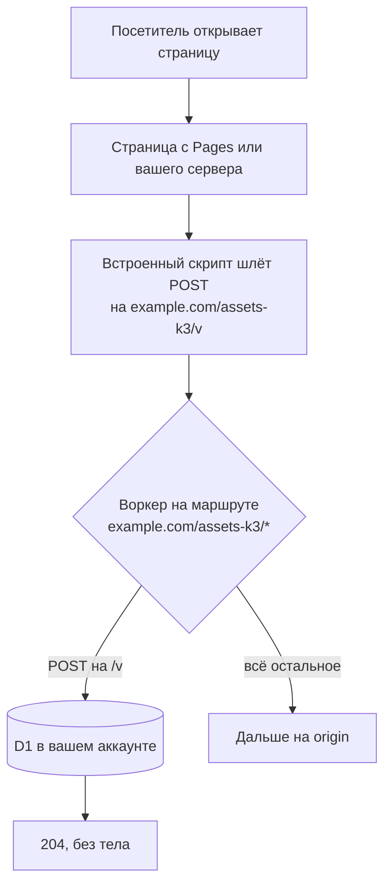

# Счётчик посещений на Cloudflare без чужого скрипта и без cookie

Скрипт Web Analytics грузится с чужого хоста, и его режут CSP и блокировщики. Воркер на пути вашего сайта считает просмотры, переходы по коротким ссылкам и QR-кодам.

Source: https://ru.301.sh/count-visits-without-a-third-party-script/
Published: 2026-10-11
Cloudflare facts checked: 2026-10-11

---

> Сайт у меня статический, на Cloudflare. Хочу видеть, сколько человек читает какую страницу
> и сколько отсканировали QR-код с листовки. Без баннера про cookie и без того, чтобы мои
> посетители ходили на чужой сервер.

На первую половину вопроса у Cloudflare есть бесплатный ответ, и многим сайтам его хватает.
С него и начнём, потом посмотрим, где он перестаёт считать, и соберём замену: воркер на одном
пути вашего же сайта. Он пишет просмотры и переходы по коротким ссылкам и QR-кодам в базу D1
в вашем собственном аккаунте. Все лимиты Cloudflare ниже сверены с её документацией
11 октября 2026 года.

## Что Cloudflare даёт бесплатно

[Web Analytics](https://developers.cloudflare.com/web-analytics/about/) бесплатна. Cloudflare
называет её "privacy-first analytics" и пишет, что она "does not collect or use your
visitors' personal data". На проксируемом домене она включается в дашборде, и скрипт
Cloudflare вставляет в ваш HTML сама. Условия — в
[FAQ](https://developers.cloudflare.com/web-analytics/faq/): данные хранятся за последние
шесть месяцев, и "We retain unsampled beacon data for the past 7 days, after this point data
is aggregated down to around 10%."

Если страницы этот скрипт загружают, чужой хост вас не смущает и считать нужно только
страницы, дальше можно не читать. Это бесплатно и не требует никакой настройки.

## Где Web Analytics перестаёт считать

**Строгая Content Security Policy его не пускает.** Скрипт лежит по адресу
`static.cloudflareinsights.com/beacon.min.js`. При автоматической установке отчёты уходят на
`/cdn-cgi/rum` вашего же домена, так что `connect-src 'self'` достаточно. Но сам скрипт
грузится с чужого хоста, и FAQ просит добавить его в `script-src`. Наш блог — живой пример.
Его политика — `script-src 'self' 'unsafe-inline'`. 11 октября 2026 года в странице 301.sh
нашёлся вставленный тег, с атрибутом `integrity` и токеном сайта, и Chrome его заблокировал:

```text
blockedURI:        https://static.cloudflareinsights.com/beacon.min.js
violatedDirective: script-src-elem
disposition:       enforce
```

Размер загрузки у ресурса — 0, объект маяка так и не появляется. Cloudflare вставляет тег, не
глядя на политику. В дашборде пусто, и о причине говорит только строка в консоли браузера.

**Блокировщики режут его по имени.** В FAQ Cloudflare есть раздел с заголовком "The analytics
beacon is blocked by ad-blockers", и ответ в нём — "Cloudflare is aware". Список
[EasyPrivacy](https://github.com/easylist/easylist/tree/master/easyprivacy) на 11 октября 2026
года блокирует сам хост, `||cloudflareinsights.com^$third-party`, и вдобавок держит общие
правила по пути, которые срабатывают на любом сайте: `/beacon.min.js`, `/cdn-cgi/rum?` и
`/cdn-cgi/rum|`. Отчёт на свой домен не помогает, раз путь у всех сайтов на Cloudflare
одинаковый.

**Он считает страницы, а не ссылки.** QR-код на листовке, ссылка в рассылке или в профиле
ведут на страницу, только если вы её специально сделаете. Сам переход и то, какой код
отсканировали, просмотром страницы не являются.

## Идея: сборщик на пути вашего сайта

Воркер можно повесить на маршрут, который покрывает один путь домена, например
`example.com/assets-k3/*`. Всё за пределами этого пути идёт на ваш origin, как и раньше. Туда
же уходит и всё внутри пути, на что воркер не отвечает сам: он передаёт запрос дальше через
`fetch(request)`. Страница при загрузке отправляет на этот путь один маленький запрос. Для
браузера, CSP и списков блокировщиков это `POST` на свой же origin, на путь, ничем не
отличающийся от остальных.



Статическому сайту это тоже подходит.
[Документация Pages](https://developers.cloudflare.com/pages/how-to/add-custom-http-headers/)
описывает воркер "on the same custom domain as your Pages project", и так же устроен
[гайд по TDS](/tds-on-cloudflare-workers/) в этом блоге. Важен порядок. В списке
[известных проблем](https://developers.cloudflare.com/pages/platform/known-issues/) Pages
сказано:
"It is currently not possible to add a custom domain with … a Worker already routed on that
domain." Сначала подключите к Pages свой домен, потом добавляйте маршрут.

Минимальная версия — одна таблица, один воркер и одна строка на странице:

```sql
CREATE TABLE views (day TEXT, page TEXT, n INTEGER, PRIMARY KEY (day, page));
```

```js
export default {
  async fetch(request, env) {
    const url = new URL(request.url);
    if (request.method === 'POST' && url.pathname === '/assets-k3/v') {
      const day = new Date().toISOString().slice(0, 10);
      const body = (await request.text()).slice(0, 200);
      const page = body.startsWith('/') ? body : 'unknown';
      await env.DB.prepare(
        'INSERT INTO views (day, page, n) VALUES (?, ?, 1) ' +
          'ON CONFLICT (day, page) DO UPDATE SET n = n + 1'
      ).bind(day, page).run();
      return new Response(null, { status: 204, headers: { 'cache-control': 'no-store' } });
    }
    return fetch(request);
  },
};
```

```html
<script>navigator.sendBeacon('/assets-k3/v', location.pathname)</script>
```

Маршрут — `example.com/assets-k3/*`, у воркера привязка D1 с именем `DB`. Страница сама
передаёт свой путь в теле запроса. Его нёс бы и `Referer` маяка, но только пока это разрешает
`Referrer-Policy` сайта: при `no-referrer` заголовка нет, при `origin` в нём остаётся один
домен, и все просмотры записались бы на `/`. Если в теле не путь, просмотр уходит в `unknown`.
Понадобятся источники — отправляйте вместе с путём `document.referrer`. Учтите, что `slice`
ограничивает только то, что попадёт в D1: `request.text()` к этому моменту уже прочитал тело
целиком. Счётчик, открытый всему интернету, читает поток сам и обрывает его после порога —
clx, например, на 2 KB.

Путь называйте так, как назвали бы папку с картинками. Имена вроде `stats`, `track` или
`beacon` — ровно то, на что написаны общие правила из списка выше.

### Как считать людей без cookie

Счётчик просмотров — просто сумма. Счётчику посетителей нужно понимать, видел ли он
человека раньше, и обычно это узнают через cookie. Без cookie это делается хэшем от того, что
запрос и так несёт, с солью, которая живёт один день:
`sha256(day salt | site | IP | user agent)`. Храните хэши открытого дня, считайте различные, а
при закрытии дня оставьте число и удалите и хэши, и соль. Соль берите из
`crypto.getRandomValues` и никогда не пишите в логи. После удаления соли даже вы не сможете
связать записи с конкретным человеком.

Считаются при этом не люди, а разные сочетания адреса и браузера за день. Это близко, но не
одно и то же. Телефон, который ушёл с домашнего интернета на мобильный, посчитается дважды;
двое коллег за одним офисным адресом с одинаковым браузером — один раз. За неделю число
складывается из уникальных за каждый день, и человек, читавший в понедельник и в четверг,
посчитан дважды. Так это и стоит подписать в отчёте.

## Короткие ссылки и QR на том же воркере

Короткая ссылка — это редирект, а редирект не выполняет JavaScript, так что скрипт на
странице переход никогда не увидит. В статье
[о подсчёте кликов по редиректу](/count-clicks-on-a-redirect/) разобрано, почему посчитать
переход может только тот, кто на запрос отвечает. Если воркер уже пишет просмотры в D1, он же
может отвечать по ссылкам и складывать клики в те же таблицы.

Ссылки живут на своём домене, например `k7q.example.com`, и origin за ним не нужен.
[Workers Custom Domains](https://developers.cloudflare.com/workers/configuration/routing/custom-domains/)
для этого и сделаны: "Cloudflare will create DNS records and issue necessary certificates on
your behalf." В документации помехой названа только уже существующая запись CNAME. Замер на
живом аккаунте 11 октября 2026 года показал, что мешает любая существующая запись: API
отвечает `409` с кодом `100117`, "already has externally managed DNS records". Запись,
которую кто-то завёл руками, никогда не будет перехвачена.

Чтобы цифрам можно было верить, нужны три вещи:

- отвечать `302` с `cache-control: no-store`, иначе браузер закэширует редирект и следующий
  клик до воркера не дойдёт;
- ставить метку в адрес, который печатается в QR-коде, `k7q.example.com/menu?q`, записывать
  такой переход с источником `qr` и не передавать метку дальше;
- считать `GET`, а `HEAD` перенаправлять без учёта: такие запросы шлют сервисы проверки ссылок и
  сервисы превью.

Правила по стране и устройству проверяются там же, где ищется сама ссылка. Страну даёт
`request.cf.country`, тип устройства определяют по User-Agent. Срабатывает первое подошедшее
правило, всё остальное уходит на основной адрес ссылки.

## Если посетители из России

С июня 2025 года Cloudflare
[сообщает](https://blog.cloudflare.com/russian-internet-users-are-unable-to-access-the-open-internet/),
что российские провайдеры дают посетителям сайтов за Cloudflare загрузить "only the first
16 KB of any web asset", а дальше обрывают соединение. Для русскоязычного сайта это главный
вопрос, и ответ на него в две части.

Сам счётчик в этот порог укладывается с большим запасом. Встроенный скрипт меньше 600 байт,
ответ на просмотр — пустой `204`. Ссылка отвечает одними заголовками, вместе с заголовками
Cloudflare это меньше 1 KB. Мерили по размеру ответа, снаружи России, а не изнутри.

Но счётчик не спасает саму страницу. Браузер успеет разобрать то, что пришло до обрыва, и
если встроенный скрипт стоит в этой части, просмотр может дойти. Если не стоит или страница
оборвалась раньше, считать будет нечего: посетитель, которого обрезали, в отчёт просто не
попадёт, и выглядеть это будет как отсутствие трафика, а не как ошибка. С короткой ссылкой лучше: редирект доходит
целиком, и дальше всё решает то, где лежит целевой сайт. Если он не за Cloudflare, посетитель
до него дойдёт. Этот блог по той же причине отдаёт русские статьи с GitHub Pages, а не с
Cloudflare.

## Сколько это стоит на Free

Workers Free даёт аккаунту
[100 000 запросов в сутки](https://developers.cloudflare.com/workers/platform/limits/) и 10 ms
процессорного времени на запрос.
[D1 на Free](https://developers.cloudflare.com/d1/platform/pricing/) — 5 миллионов
прочитанных и 100 000 записанных строк в сутки, 500 MB на базу и 5 GB на аккаунт. Квоты
сбрасываются в 00:00 UTC и общие для всех воркеров аккаунта.

Первыми кончаются записи. Каждое учтённое событие трогает хотя бы одну строку, а с хэшами
посетителей и почасовой детализацией — больше, и D1 считает записанной строкой каждую запись
в индексе. clx, о котором ниже, закладывает девять записей на самое дорогое событие и
оценивает гарантированный потолок на Free примерно в 11 000 событий в сутки; у обычного сайта
выходит в разы больше.

Когда квота кончается, ломается разное. Сверх лимита запросов Cloudflare
[отдаёт Error 1027](https://developers.cloudflare.com/workers/platform/limits/) или пропускает
воркер и отправляет запрос на origin — смотря как настроен маршрут. В обоих случаях ничего не
считается, а короткие ссылки перестают отвечать: у их домена нет origin, на который можно
уйти. Ваши страницы на маршруте не стоят и продолжают открываться. Сверх лимита записей D1
"will return errors": подсчёт останавливается. Продолжат ли работать ссылки, зависит от кода.
Пример выше ждёт записи и упадёт вместе с ней. clx пишет клик через `ctx.waitUntil()` уже
после отправки редиректа и молча отбрасывает неудачную запись, поэтому его ссылки продолжают
перенаправлять. Workers
Paid снимает оба ограничения
[минимум за $5 в месяц](https://developers.cloudflare.com/workers/platform/pricing/) на
аккаунт, в тариф входят 10 миллионов запросов и 50 миллионов записей D1.

## Где это ломается

- **Подделке он не помешает.** Путь виден в исходнике страницы, и отправить туда `POST` с
  любым `Referer` и User-Agent может кто угодно. Проверка `Origin` и домена отсекает шум
  браузеров, но не целенаправленный скрипт.
- **Маршрут должен быть свободен.** Если на этом шаблоне уже стоит маршрут другого воркера,
  второй Cloudflare не создаст. Выберите другой путь, а не перезаписывайте чужой.
- **Встроенному скрипту нужно разрешение вашей CSP.** Если в `script-src` есть `'self'`, но
  нет `'unsafe-inline'`, отдавайте тот же код файлом с пути воркера,
  `<script defer src="/assets-k3/a.js">`, — `'self'` его пропустит. Сам маяк проверяется по
  `connect-src`, поэтому политике, которая начинается с `default-src 'none'`, нужен ещё и
  `connect-src 'self'`.
- **Browser Integrity Check — настройка вашей зоны.** Она может заблокировать некоторые
  скриптовые клиенты на домене ссылок ещё до воркера. Браузеры проходят, ваш собственный скрипт
  мониторинга — не обязательно.
- **Собственные файлы Pages за воркером здесь не проверены.** Действуют ли `_redirects` и
  `_headers` проекта Pages на запросы, которые воркер передал дальше, для этой статьи не
  проверяли.

## Если не хочется писать это самому

Код выше — рабочее начало. Довести его до счётчика с источниками, странами, устройствами,
ботами, хэшами посетителей, закрытием дней, правилами ссылок, QR-кодами и отчётом — отдельный
проект, и этот проект называется [clx](https://clx.cx). Он ставит в ваш аккаунт Cloudflare
воркер `clx-edge` и базу D1, используя короткоживущий bootstrap-токен, который вы создаёте
сами. У себя он хранит только итоги: почасовые за два дня и суточные за 400 дней, а
детализация остаётся в вашем аккаунте. У каждого сайта свой путь и свой сгенерированный
сниппет, так что два сайта на clx ничем не похожи в исходном коде. Ссылкам выдаётся свой
домен на каждый сайт, к каждой ссылке — QR-код и до 10 правил. Бесплатный тариф — один
аккаунт Cloudflare, 10 сайтов и 200 ссылок. Исходный код открыт под AGPL-3.0.

Генераторам сайтов браузер не нужен. Через API они один раз подключают аккаунт Cloudflare
клиента, добавляют каждый сайт и получают сниппет, который вшивается при сборке и не меняется
от сборки к сборке. [Site Generator](https://generator.ink), который публикует партнёрские
сайты на Pages, включает счётчик клиенту по запросу в поддержку.

## Когда нужен 301.st

Для одного сайта и нескольких ссылок воркера выше или clx хватает целиком, и оба варианта
бесплатны. [301.st](https://301.st) решает другую задачу: много доменов с редиректами по
стране и устройству, сплит трафика между офферами или лендингами, отсев ботов до того, как они
туда попадут, и [постбеки](/postbacks-for-a-tds/), по которым видно, какой клик дал
конверсию. Он так же работает в вашем аккаунте Cloudflare, а короткая ссылка clx может вести
в поток 301.st, если нужно и то и другое.
